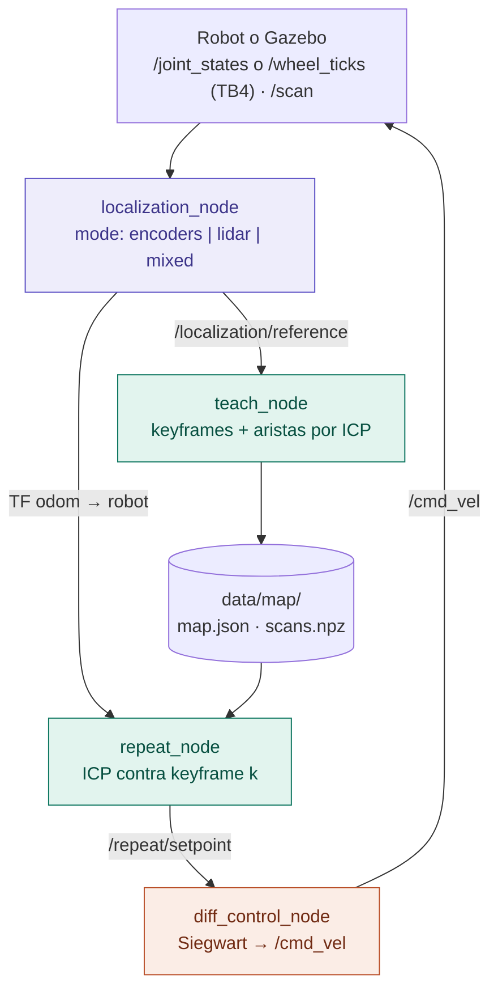
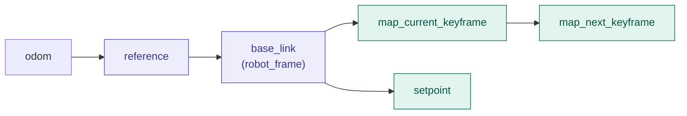

# Arquitectura Teach and Repeat (TP1)

Diseño acordado para el TP1: un localizador local con tres modos y, por encima,
una capa de Teach and Repeat que se relocaliza con ICP contra los keyframes
enseñados. Incluye el contrato de interfaces, el plan de trabajo y el reparto
entre tres personas.

> Estado: **implementado**. Este documento es el diseño de referencia: donde el
> código y el documento difieran, vale el código. Cómo correrlo está en el
> [`README.md`](../../README.md).

## Índice

1. [Idea](#idea)
2. [Nodos y flujo de datos](#nodos-y-flujo-de-datos)
3. [Árbol de TF](#árbol-de-tf)
4. [Contrato de interfaces](#contrato-de-interfaces)
5. [Algoritmos](#algoritmos)
6. [Decisiones acordadas](#decisiones-acordadas)
7. [Plan global](#plan-global)
8. [Reparto entre tres personas](#reparto-entre-tres-personas)
9. [Pendientes](#pendientes)

## Idea

Hay **dos capas de localización**:

- **Capa 1, `localization_node`:** estima cuánto se movió el robot desde su
  última referencia, con encoders, con LiDAR o con ambos. No sabe nada del mapa
  y se usa igual en Teach y en Repeat.
- **Capa 2, Teach and Repeat:** compara el scan actual con los scans guardados
  en Teach. En Teach la usa `teach_node` para refinar las aristas entre
  keyframes; en Repeat la usa `repeat_node` para saber dónde está el robot
  respecto del keyframe que está siguiendo.

En el Repeat, la odometría de la capa 1 cumple tres funciones: dar la
estimación inicial del ICP, cubrir los momentos en que el ICP falla y
actualizar la pose entre scans. La medición que manda siempre es el ICP contra
el mapa. Es la estructura de Sprunk et al. (2013), que está en
[`docs/clase4`](../clase4).

## Nodos y flujo de datos



`teach_node` y `repeat_node` también leen `/scan` directamente; no está
dibujado para no cruzar flechas.

## Árbol de TF



Es el árbol que pide la consigna. Funciona porque son dos localizaciones
distintas: ningún frame tiene dos padres. Para que eso valga, la TF `odom →
base_*` del robot no puede llegar al mismo `/tf` que la nuestra. En simulación,
`sim_launch.py` **apaga la TF de odometría de Gazebo**. En el TB4 no se apaga
nada: el Create 3 publica en `/tb4_1/tf` y nuestros nodos en `/tf`, así que los
dos árboles no se encuentran.

| Transformación | Quién | Qué representa |
|---|---|---|
| `odom → reference` | `localization_node` | Pose de la referencia actual del localizador. En Teach, la referencia es el último keyframe. |
| `reference → base_link` | `localization_node` | Pose del robot respecto de esa referencia. Es lo mismo que `/rel_odom`. |
| `base_link → map_current_keyframe` | `repeat_node` | Keyframe enseñado que se está siguiendo, visto desde el robot (inversa del resultado del ICP). |
| `map_current_keyframe → map_next_keyframe` | `repeat_node` | Arista guardada en el mapa entre el keyframe k y el k+1. |
| `base_link → setpoint` | `repeat_node` | Objetivo instantáneo del controlador: el keyframe k+1, o el k si es el último. |

Las tres primeras filas del árbol (`odom → reference → base_link`) existen en
Teach y en Repeat; el resto, solo en Repeat.

En el TB3 el frame raíz del robot es `base_footprint`
(`base_footprint → base_link → base_scan`), así que `robot_frame` vale
`base_footprint` en simulación. En el TB4 vale `base_link`: allá `base_footprint`
solo cuelga de `odom` y no está conectado a `rplidar_link`. Lo fija el perfil
del robot, y `tb4_launch.py` publica en nuestro `/tf_static` el montaje del
LiDAR (`base_link → rplidar_link`).

## Contrato de interfaces

Esto es lo que hay que congelar el primer día. Con estos nombres y firmas
fijos, cada persona puede trabajar por su lado sin pisarse.

### Paquetes

```text
marauder/
├── rota_common/            librería compartida, sin nodos ni launches
│   ├── cmd_vel.py
│   └── se2.py  msgs.py  scan.py  icp.py  tnr_map.py
├── rota_localization/      capa 1 y odometrías
│   ├── localization_node.py
│   └── wheel_odometry_node.py  lidar_odometry_node.py
├── rota_mapping/           mapa de ocupación
│   └── mapper_node.py
├── rota_control/           capa 2 + control
│   └── teach_node.py  repeat_node.py  diff_control_node.py
└── rota_bringup/           launches, simulación y perfiles de robot
    ├── launch/   sim  tb4  teach  repeat  diff_control  wheel_odometry  lidar_odometry  mapper
    └── config/   teach.rviz  repeat.rviz  tb3_sim.yaml  tb4.yaml
```

### `rota_common` (librería)

Convención: una pose es `(x, y, θ)`; `compose(a, b) = a ⊕ b` y
`between(a, b) = a⁻¹ ⊕ b`, que es la pose de `b` vista desde `a`.

```text
se2.py      normalize_angle(a) · compose(a, b) · inverse(a) · between(a, b) · norm(a)
            to_matrix(p) → 4x4 · from_matrix(T) → (x, y, θ)
            yaw_from_quaternion(q) · quaternion_from_yaw(yaw)
msgs.py     pose_to_msg(p) · pose_from_msg(msg) · pose_stamped(stamp, frame, p)
            transform_stamped(stamp, parent, child, p) · pose_from_transform(msg)
scan.py     scan_to_points(msg, rmin, rmax) → (N, 2) en el frame del LiDAR
            project(msg, tf_buffer, robot_frame, rmin, rmax) → (N, 2) en robot_frame | None
            # usa la TF fija del LiDAR; None mientras no esté
icp.py      align(source, target, guess, max_distance=0.30, max_iterations=30, min_fitness=0.25)
                → (pose, fitness, ok)
            # pose = pose del robot de source en el frame del robot de target
            # point-to-plane; si no corre, devuelve la guess con ok=False
tnr_map.py  Keyframe(id, stamp, pose_odom, edge_from_prev, edge_fitness, edge_icp_ok, points)
            save(map_dir, keyframes, meta) · load(map_dir) → (meta, keyframes)
            chain_poses(keyframes) → poses en el frame del keyframe 0
```

### `localization_node` (capa 1, Teach y Repeat)

| | |
|---|---|
| Suscribe | `/joint_states` o `/wheel_ticks` (TB4), según `wheel_source` (encoders, mixed) · `/scan` (lidar, mixed) |
| Publica | `/rel_odom` · `nav_msgs/Odometry`, frame `reference`, child `robot_frame` |
| | `/localization/reference` · `PoseStamped` en `odom`, solo cuando se crea una referencia nueva. El stamp es el del mensaje del sensor que la creó. QoS reliable, depth 100. |
| | `/localization/odom` · `Odometry` `odom → robot_frame`, para paths y gráficos |
| TF | `odom → reference` · `reference → robot_frame` |
| Parámetros | `mode` · `tau_d` 0.30 m · `tau_theta` 0.30 rad · `robot_frame` · `wheel_source` (`joint_states` o `ticks`) · `left_wheel_joint` / `right_wheel_joint` (por nombre) · `wheel_radius` · `meters_per_tick` · `wheel_separation` · `min/max_scan_range` · `icp_max_distance` · `icp_max_iterations` · `icp_min_fitness` |

### `teach_node` (capa 2, Teach)

| | |
|---|---|
| Suscribe | `/localization/reference` · `/scan` (en un buffer de unos 50 scans) · `/localization/odom` (para el path) |
| Publica | `/teach/path` (`Path` en `odom`) · `/teach/keyframes` (`MarkerArray`) |
| Servicios | `~/save` (`Trigger`). También guarda al apagarse. |
| Parámetros | `map_dir` (ruta absoluta en el log) · `robot_frame` · `min/max_scan_range` · `icp_*` · `mode`, `tau_d`, `tau_theta` (solo para la metadata de `map.json`; tienen que coincidir con los de `localization_node`) |

### `repeat_node` (capa 2, Repeat)

| | |
|---|---|
| Suscribe | `/scan` · TF `odom → robot_frame`, consultada al stamp del scan (los scans esperan en una cola y `control()` toma los que ya tienen TF; descarta el que no la tiene a los 0.2 s). Frena si la última TF tiene más de 0.5 s |
| Publica | `/repeat/setpoint` (`PoseStamped` en `robot_frame`) · `/repeat/taught_path` (en `map_current_keyframe`) · `/repeat/actual_path` |
| TF | `robot_frame → map_current_keyframe` · `map_current_keyframe → map_next_keyframe` · `robot_frame → setpoint` |
| Servicios | `~/run` (`SetBool`): `true` arranca o reanuda, `false` pausa. Arranca pausado. En pausa sigue procesando scans y publica el setpoint identidad, así que el robot queda quieto. |
| Parámetros | `map_dir` · `advance_dist` 0.20 m · `advance_angle` 0.15 rad · `control_frequency` 20 Hz · `icp_*` |

### `diff_control_node` (control)

| | |
|---|---|
| Suscribe | `goal_topic` = `/repeat/setpoint`. Si el frame del objetivo es `robot_frame`, toma la pose del robot como (0, 0, 0). Se mantiene el modo `/goal_pose` en `odom` de la clase 4. |
| Publica | `cmd_vel_topic` (`/cmd_vel` en simulación, `<ns>/cmd_vel` en el TB4) · `cmd_vel_type`: `auto` en el TB3, `twist` en el TB4 |
| Frenado | Con un setpoint identidad, el objetivo está alcanzado y publica velocidad cero. Si pasa `goal_timeout` (0.5 s en `repeat_launch.py`, 0 = apagado) sin setpoint, frena. |
| Parámetros para el Repeat | `goal_topic:=/repeat/setpoint` · `use_tf:=true` · `reference_frame` y `robot_frame` del perfil (`base_footprint` en el TB3, `base_link` en el TB4) |

### Mapa en disco (`data/map/`)

```text
map.json   { "robot_frame": "base_footprint", "mode": "encoders", "tau_d": 0.30, "tau_theta": 0.30,
             "keyframes": [ { "id": 0, "stamp": 12.4, "pose_odom": [x, y, θ],
                              "edge_from_prev": [dx, dy, dθ], "edge_fitness": 0.83,
                              "edge_icp_ok": true, "num_points": 312 }, … ] }
scans.npz  kf_0000, kf_0001, … → (N, 2) puntos en robot_frame
```

El Repeat sigue la cadena de `edge_from_prev`; `pose_odom` se usa solo para
graficar.

### Launches y simulación

- `rota_bringup/launch/sim_launch.py`: solo la simulación (mundo de Gazebo,
  TB3 con `publish_odom_tf` en false). Se corre aparte de Teach y Repeat:
  `ros2 launch rota_bringup sim_launch.py`.
- `teach_launch.py mode:=… map_dir:=… rviz:=true` lanza `localization_node`,
  `teach_node` y RViz.
- `repeat_launch.py mode:=… map_dir:=… rviz:=true` lanza
  `localization_node`, `repeat_node`, `diff_control_node` y RViz.
- `robot:=tb3_sim|tb4` carga `config/<robot>.yaml` como parámetros de todos los
  nodos del launch: `use_sim_time`, `robot_frame` y `reference_frame`,
  `wheel_source`, la geometría (`wheel_radius` o `meters_per_tick`, y
  `wheel_separation`), `max_scan_range` y `cmd_vel_type`. `ns:=/tb4_1` es el
  namespace del robot: remapea `/scan` y `/wheel_ticks` dentro de él y manda el
  control a `<ns>/cmd_vel`.
- `tb4_launch.py` se corre una vez antes de Teach o Repeat en el TB4: publica el
  montaje del LiDAR en `/tf_static`. No hay que apagar nada en el Create 3.

## Algoritmos

### Localizador: los tres modos

| Modo | Cómo actualiza `reference → robot` | Cuándo crea una referencia |
|---|---|---|
| `encoders` | Integra los deltas de las ruedas en cada `/joint_states` o `/wheel_ticks`. | Cuando se supera `tau_d` o `tau_theta`. |
| `lidar` | ICP del scan actual **contra el scan de la referencia**, no contra el scan anterior. Estimación inicial: la última `rel_odom` más la última velocidad (modelo de velocidad constante). | En un scan que supera el umbral; ese scan pasa a ser la referencia. |
| `mixed` | Entre scans integra los encoders. Cuando llega un scan, corre ICP contra la referencia usando esa integración como estimación inicial. | En un scan que supera el umbral. Si el LiDAR se corta, no se crean referencias nuevas. |

```text
nueva_referencia(stamp, puntos):
    T_odom_ref = T_odom_ref ⊕ T_ref_robot      # la TF odom → robot no salta
    T_ref_robot = identidad
    publicar /localization/reference(stamp, T_odom_ref)
```

### Teach: un keyframe por referencia

```text
al llegar /localization/reference (stamp, pose_n):
    scan_n = el scan del buffer más cercano a stamp   # si todavía no llegó, se espera al siguiente
    puntos_n = scan_to_points(scan_n) en robot_frame
    si hay keyframe anterior:
        guess = between(pose_{n-1}, pose_n)            # de las poses de las referencias, no de /rel_odom
        r = icp.align(puntos_n, puntos_{n-1}, guess)
        arista = r.pose si r.ok, si no guess           # se guardan el fitness y edge_icp_ok
    guardar Keyframe(n, stamp, pose_n, arista, puntos_n)

al guardar el mapa (~/save o al apagarse):
    pose_fin = última /localization/odom
    si se movió ≥ 2 cm o 0.02 rad desde el último keyframe:
        agregar al mapa un keyframe más en pose_fin, igual que los otros   # el tramo final no se pierde
```

En modo lidar este ICP repite el último cálculo del localizador y sirve de
control. En modo encoders es lo que hace que el mapa quede refinado por ICP.

### Repeat: seguir la cadena de keyframes

```text
inicio: k = 0, T_kf_robot = identidad                  # se supone que arranca en el inicio del Teach

por cada scan (t):
    odom_t = TF odom → robot al tiempo t
    guess  = T_kf_robot ⊕ between(odom_ultimo, odom_t)
    r = icp.align(puntos(scan), puntos_kf[k], guess)
    T_kf_robot = r.pose si r.ok, si no guess
    odom_ultimo = odom_t
    mientras k < N-1:
        T_next_robot = between(arista[k+1], T_kf_robot)
        cerca_o_paso = norm(T_next_robot) < advance_dist o T_next_robot.x ≥ 0   # cerca del siguiente, o ya lo pasó
        si norm(arista[k+1]) < advance_dist:                    # k+1 es casi un giro en el lugar
            giro = T_next_robot.θ · signo(arista[k+1].θ) > -advance_angle   # ya giró hasta k+1, o más
        si no: giro = verdadero
        si cerca_o_paso y giro:
            T_kf_robot = T_next_robot; k += 1                   # cambia de marco sin relocalizar
        si no: salir

a control_frequency:
    pose = T_kf_robot ⊕ between(odom_ultimo, odom_ahora)
    objetivo = arista[k+1] si k < N-1, si no identidad
    setpoint = between(pose, objetivo)                 # en robot_frame
    si k == N-1: el setpoint queda en el último keyframe y el controlador frena
                 con su propia tolerancia (un setpoint identidad ya llegó tarde: el pose es del último scan)
    publicar setpoint y las TF
```

## Decisiones acordadas

- **Keyframes del Teach = referencias del localizador.** Con los mismos
  umbrales, `/rel_odom` es exactamente "la pose relativa al último keyframe",
  como pide la consigna.
- **El ICP es contra el scan de referencia, no contra el scan anterior.** Así
  el error se acumula una vez por referencia y no una vez por scan.
- **Las aristas del Teach se calculan siempre con ICP.** La calidad del mapa no
  depende del modo. La estimación inicial sale de las poses de las dos
  referencias.
- **El Repeat usa del localizador solo el movimiento continuo.** Las
  referencias propias del localizador durante el Repeat son internas. Como el
  Repeat solo usa deltas, no depende del origen de `odom`.
- **Setpoint = keyframe siguiente.** Es lo que pide la consigna y lo que hace
  el código actual. Un lookahead sobre la cadena queda como mejora posible.
- **En los giros en el lugar, para avanzar también cuenta el ángulo.**
  Agregado en el PR de Teach and Repeat (persona B), para revisar. Un giro en
  el lugar en el Teach deja un keyframe cada `tau_theta`, todos en el mismo
  punto. Con la regla de solo distancia el Repeat los salteaba todos de golpe
  y no hacía el giro: en una prueba con un giro de 180°, pasaba por 4 de 16
  keyframes. Ahora, si el keyframe siguiente está a menos de `advance_dist`
  del actual, además hay que haber girado hasta `advance_angle` de su
  orientación, o más allá. Así pasa por los 16. Los keyframes que avanzan más
  que `advance_dist` siguen con la regla de distancia, para no frenar al robot
  si en una curva queda adelantado. El controlador no cambia: con el objetivo
  a menos de `dist_tolerance` ya gira en el lugar.
- **El Teach guarda un keyframe más al final.** Agregado en el PR de Teach and
  Repeat (persona B), para revisar. Las referencias salen cada `tau_d` o
  `tau_theta`, así que el Teach casi siempre termina entre dos, y el tramo
  posterior a la última referencia (hasta `tau_d`) no quedaba en el mapa. En
  Gazebo, en modos lidar y mixed, faltaban 29 cm del final. Ahora, al guardar,
  `teach_node` agrega un keyframe en la última pose de `/localization/odom`,
  con su scan y su arista por ICP, si el robot se movió desde el último.
- **El setpoint va en el frame del robot.** El controlador no necesita
  localizarse. Con un setpoint identidad frena, y además hay un timeout de
  seguridad.
- **El Repeat siempre se relocaliza contra el keyframe enseñado**, como en
  Sprunk et al.

## Plan global

| Etapa | Qué incluye | Resultado |
|---|---|---|
| **0. Contrato** | Congelar nombres de tópicos, frames y parámetros, el formato del mapa y las firmas de `rota_common` (este documento). Los tres juntos, el primer día. | Contrato acordado |
| **1. Base** | `rota_common`, el launch de simulación con el bridge sin `tf` y el modo encoders del localizador. | Un Teach con encoders graba un mapa |
| **2. T&R con encoders** | `teach_node` con aristas por ICP, `repeat_node` completo y `diff_control_node` adaptado. | El robot repite en simulación · **4 pts** |
| **3. Lidar y mixto** | Modo lidar con modelo de velocidad constante y modo mixto. | Los tres modos funcionan en Teach y Repeat · **4 + 2 pts** |
| **4. Evaluación, robot real y entrega** | Ground truth de Gazebo, gráficos de Teach vs Repeat por modo con y sin ICP de mapa, puesta en marcha en el TB4, README, presentación de 5 minutos y demo. | Entrega |

## Reparto entre tres personas

Cada persona es dueña de archivos distintos, así nadie edita el mismo archivo
que otro. Las dependencias entre personas se reducen a las firmas del contrato.

### Persona A: localización

- `se2`, `msgs`, `scan` e `icp`. Se entregan primero, el primer o
  segundo día.
- `localization_node`: encoders, después lidar, después mixto.
- TB4: ticks de las ruedas (`/wheel_ticks`) y geometría.

Archivos: `rota_common/{se2,msgs,scan,icp}.py` · `rota_localization/`

### Persona B: Teach and Repeat

- `tnr_map`: guardar, cargar y encadenar aristas.
- `teach_node`: buffer de scans, avisos de referencia, aristas por ICP,
  guardado y visualización.
- `repeat_node`: ICP contra el keyframe, Δodom, avance, TF y setpoint.

Archivos: `rota_common/tnr_map.py` · `rota_control/{teach,repeat}_node.py`

### Persona C: control e infraestructura

- Launch de simulación y bridge sin `tf`, al principio porque todos lo
  necesitan.
- `diff_control_node`: setpoint en el frame del robot, identidad para frenar y
  timeout.
- Perfiles `tb3_sim`/`tb4`, `teach_launch`/`repeat_launch` y las
  configuraciones de RViz.
- Ground truth, script de gráficos y README. TB4: tópicos (ticks, scan,
  `cmd_vel`), QoS, TF privada y montaje del LiDAR.

Archivos: `rota_control/diff_control_node.py` · `rota_bringup/` ·
`rota_mapping/` · `README.md`

### Cómo se desbloquean entre sí

1. Etapa 0 entre los tres. Después, A entrega la librería base y C el launch
   de simulación lo antes posible.
2. B escribe `tnr_map` y el esqueleto del Teach contra las firmas acordadas,
   sin esperar la implementación.
3. Con el modo encoders de A, B prueba Teach y Repeat de punta a punta
   (etapa 2) mientras A sigue con lidar y mixto, y C con el controlador y la
   evaluación.
4. En la etapa 4 los tres corren los experimentos de cada modo y preparan la
   presentación.

## Pendientes

- **Profesor:** ¿los 4/4/2 puntos se refieren al modo de la capa 1, con el ICP
  de mapa activo en los tres?
- **Profesor:** `/rel_odom` lo publica `localization_node`, lanzado dentro de
  `teach_launch.py`. ¿Cuenta como "el nodo de aprendizaje"?
- **Cerrado:** `rota_control` no se renombra a `rota_tnr`.
- **Equipo:** de qué tópico de gz sale el ground truth (pose del modelo) y cómo
  se graba en cada corrida.
