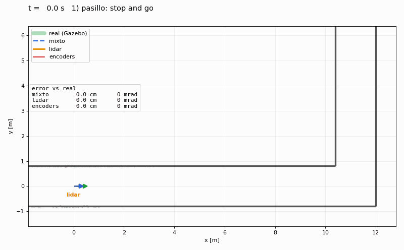
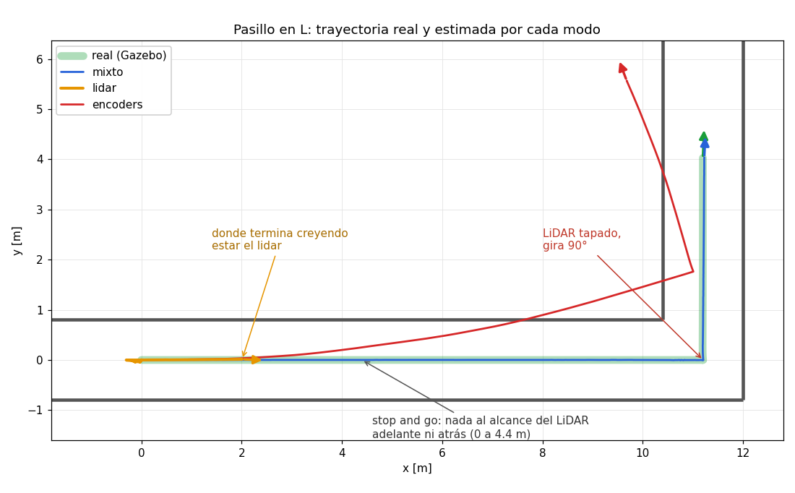

# Localización (capa 1): estado y resultados

Implementación de la persona A según [`arquitectura.md`](arquitectura.md):
la librería compartida en `rota_common` y el `localization_node` con los modos
`encoders`, `lidar` y `mixed` en `rota_localization`.



## Qué hay

| Archivo | Qué hace |
|---|---|
| `rota_common/se2.py` | `compose`, `inverse`, `between`, `norm`, matrices y cuaterniones sobre poses `(x, y, θ)`. Sin ROS. |
| `rota_common/msgs.py` | Poses ↔ `Pose`, `PoseStamped`, `TransformStamped`, `Odometry`. |
| `rota_common/scan.py` | `scan_to_points` y `ScanProjector`, que lleva los puntos a `robot_frame` con la TF fija del LiDAR. |
| `rota_common/icp.py` | `align(source, target, guess, params) → IcpResult`. Point-to-plane por defecto. |
| `rota_localization/localizer.py` | La lógica de los tres modos, sin ROS. |
| `rota_localization/localization_node.py` | El nodo: `/rel_odom`, `/localization/reference`, `/localization/odom` y TF `odom → reference → robot_frame`. |
| `rota_localization/experiments/corridor/` | El experimento del pasillo de esta página. |

Tests: `colcon test --packages-select rota_common rota_localization` (65 tests).

## Diferencias con el contrato

Hay que avisarle al resto del equipo:

- **`/localization/reference` es `TRANSIENT_LOCAL`**, además de reliable y
  depth 100. Un `teach_node` que se suscriba con `TRANSIENT_LOCAL` recibe las
  referencias que se publicaron antes de que arrancara. Una suscripción
  volátil también es compatible.
- **Parámetros nuevos del nodo:** `icp_method` (`point_to_plane` o
  `point_to_point`), `icp_degeneracy_ratio` (ver abajo), `encoder_noise_std`,
  `encoder_noise_bias` y `encoder_noise_seed`.
- **`IcpResult` tiene un campo más:** `degenerate`, que indica en cuántas
  direcciones se conservó la estimación inicial.
- **`OMP_NUM_THREADS=1`.** `icp.py` lo fija antes de importar Open3D. Con los
  threads por defecto, un ICP de 360 puntos pasaba de 0.3 ms a 200 ms con tres
  procesos haciendo ICP a la vez, y a 1 s por scan dentro del nodo. Los nodos
  que importen `open3d` por su cuenta antes que `rota_common.icp` no reciben
  el arreglo. Conviene poner `OMP_NUM_THREADS=1` en los launches.

## Decisiones sobre el ICP

- **Point-to-plane (point-to-line en 2D).** Con point-to-point el resultado se
  queda a media separación entre puntos de la verdad: cada punto se apoya en un
  vecino de la misma pared. Con scans tipo LDS la diferencia es de unos 5 mrad
  contra 0.5 mrad por alineación, y en el modo lidar ese error se acumula una
  vez por referencia.
- **Direcciones degeneradas.** En un pasillo todos los scans se ven iguales en
  el frame del robot, así que el ICP no tiene información sobre el avance: la
  menor información es unas 200 veces menor que la mayor, contra 3 veces en una
  habitación. Lo que devuelve en esa dirección es ruido que tiende a "no me
  moví". `align` detecta esas direcciones con los autovalores de la matriz de
  información y ahí conserva la estimación inicial (*solution remapping*,
  Zhang, Kaess y Singh, ICRA 2016). En `turtlebot3_world` no detecta ninguna
  dirección degenerada y los resultados no cambian.

## Resultados

### Pasillo en L

`experiments/corridor/`: un pasillo de 1.6 m de ancho, más largo que el
alcance del LiDAR (3.5 m), con una esquina a 90°. El robot hace:

1. stop and go en el primer tramo (4.4 m), sin nada al alcance del LiDAR
   adelante ni atrás;
2. sigue hasta la esquina (11.2 m) y, **con el LiDAR tapado**, gira 90° en el
   lugar;
3. recorre 4 m del segundo tramo.

Los tres modos corren en paralelo sobre el mismo robot. Las ruedas tienen 0.5 %
de diferencia de radio y ruido de 0.002 m/√m. Errores contra la pose real de
Gazebo:

| Momento | mixto | lidar | encoders |
|---|---|---|---|
| tras stop and go | 0.1 cm / 0 mrad | 441.0 cm / 1 mrad | 25.1 cm / 143 mrad |
| en la esquina | 0.2 cm / 0 mrad | 1125.7 cm / 17 mrad | 177.2 cm / 304 mrad |
| tras el giro a ciegas | 0.3 cm / 6 mrad | 1133.0 cm / 1555 mrad | 177.5 cm / 298 mrad |
| final | 3.1 cm / 6 mrad | 1002.9 cm / 1565 mrad | 216.3 cm / 404 mrad |



- **lidar:** en el pasillo no ve avance (el error de 441 cm es todo lo
  recorrido) y el giro a ciegas no lo registra (el error de orientación queda
  en ~1.57 rad = 90°).
- **encoders:** el 0.5 % de diferencia entre ruedas curva la trayectoria
  estimada.
- **mixto:** toma la orientación y la posición lateral del ICP y el avance de
  las ruedas, y durante el apagón sigue con las ruedas.

Advertencia: el ruido simulado no tiene un error de escala común a las dos
ruedas. En el robot real ese error pasaría completo al avance del mixto en un
pasillo, por ejemplo 1 % de error de escala sería ~16 cm en 16 m.

Para reproducirlo (con el workspace compilado en `$TNR_WS`, por defecto
`~/tp1_ws`):

```bash
cd rota_localization/experiments/corridor
./run.sh                                   # con Gazebo y RViz
LOG=/tmp/run.npz ./run.sh gui:=false       # sin ventanas, guardando la corrida
python3 render.py /tmp/run.npz /tmp/out    # GIF, PNG y tabla
./stop.sh
```

### `turtlebot3_world` (Gazebo)

Ocho alrededor de dos columnas, 15.6 m y ~4 vueltas, con ruedas de 2 % de
bias y ruido de 0.01. Error final:

| | encoders | lidar | mixto |
|---|---|---|---|
| Ruedas ideales | 0.4 cm / 1 mrad | 7.4 cm / 22 mrad | 7.5 cm / 22 mrad |
| Ruedas con 2 % de bias | 44.7 cm / 1581 mrad | 7.5 cm / 30 mrad | 7.3 cm / 31 mrad |

En un mundo con referencias por todos lados el mixto da lo mismo que el lidar:
mientras el ICP funcione, manda el ICP. La deriva del lidar varía entre
corridas (22 a 88 mrad en el mismo recorrido) por el ruido del LiDAR simulado.

## Para tener en cuenta

### Persona B: Teach and Repeat

- **Suscribirse a `/localization/reference` con `RELIABLE` + `TRANSIENT_LOCAL`
  y depth 100.** La referencia 0 se publica con el primer `/joint_states` (en
  modo encoders) o con el primer scan (en lidar y mixto). Con una suscripción
  volátil, un `teach_node` que arranque unos milisegundos tarde la pierde.
- **El stamp de cada referencia es el stamp exacto del mensaje que la creó.**
  En lidar y mixto es el stamp de un scan, así que el buffer de scans del Teach
  lo encuentra por igualdad. En encoders es un stamp de `/joint_states` y hay
  que buscar el scan más cercano.
- **Referencias sin scan.** En modo mixto, si el LiDAR deja de publicar más de
  `scan_timeout` (0.5 s), las referencias se crean solo con las ruedas. En ese
  caso no hay scan cerca de su stamp, y el próximo scan genera otra referencia
  enseguida. Los stamps de las referencias siempre crecen.
- **`teach_node` y `repeat_node` todavía importan `open3d` directamente**
  (`repeat_node.py:11`). Si lo importan antes que `rota_common.icp`, OpenMP
  arranca con todos los threads y el ICP pasa de ~0.5 ms a cientos de ms
  cuando corre junto al localizador. Hay que usar `rota_common.icp.align` o
  importarlo primero.
- **Mirar `IcpResult` además de `pose`.** `ok` dice si alcanzó `min_fitness`.
  `degenerate > 0` dice que en alguna dirección se conservó la estimación
  inicial: en un pasillo, el avance lo da la estimación inicial (la
  odometría), no el ICP. Por eso la estimación inicial tiene que ser buena:
  para las aristas, `between(pose_{n-1}, pose_n)` de las referencias; en el
  Repeat, el Δodom.
- **La TF `odom → robot_frame` llega a ritmos distintos según el modo.** En
  encoders y mixto se actualiza con cada `/joint_states` (30 Hz en Gazebo). En
  lidar, solo con cada scan (5 Hz en el TB3), así que pedirla "ahora" a 20 Hz
  da datos de hasta 0.2 s de atraso. En lidar, si el LiDAR se corta, deja de
  publicarse y el lookup falla: el Repeat tiene que frenar en ese caso, no
  seguir con la última pose.
- `teach_node` y `repeat_node` hoy escuchan `odom_topic` (`/odom`). En el
  diseño nuevo usan `/localization/reference` y la TF del localizador, y
  `/odom` de Gazebo deja de existir (pasa a `/ground_truth/odom`, ver abajo).

### Persona C: control e infraestructura

- **`OMP_NUM_THREADS=1` en los launches**
  (`SetEnvironmentVariable('OMP_NUM_THREADS', '1')`). Cubre cualquier nodo que
  importe `open3d` por su cuenta.
- **Apagar la TF `odom → base_footprint` de Gazebo.**
  `experiments/corridor/corridor_launch.py` (`spawn_patched_robot`) tiene un
  parche que funciona en Humble con Gazebo Classic: pone `publish_odom_tf` en
  false y manda la odometría del plugin (la pose real del modelo en el mundo)
  a `/ground_truth/odom`, con frame `world`. Eso responde el pendiente de
  "de qué tópico sale el ground truth" para Humble. En Jazzy (gz) es otro
  camino. El robot aparece en el origen, así que una TF fija `world → odom`
  identidad deja ver la pose real y las estimaciones en el mismo RViz.
- **Parámetros del localizador para los perfiles `tb3_sim`/`tb4`:** `mode`,
  `robot_frame` (`base_footprint` en el TB3, verificar en el TB4),
  `left_wheel_joint`/`right_wheel_joint`, `wheel_radius`, `wheel_separation`,
  `scan_timeout`, `icp_*` (incluido `icp_degeneracy_ratio`) y, solo en
  simulación, `encoder_noise_std`, `encoder_noise_bias` y `encoder_noise_seed`.
- **`scan_timeout` (0.5 s) está pensado para el LDS del TB3 a 5 Hz.** Con el
  LiDAR del TB4 hay que revisarlo según su frecuencia real.
- **Para los gráficos de evaluación** se pueden reusar `drive_corridor.py
  --log` (guarda la pose real, las estimaciones y los scans a 10 Hz en un
  `.npz`) y `render.py` (GIF, PNG y tabla).
- **Gazebo y RViz no abren desde la terminal de VS Code (snap)**: mueren con
  `GLib-GIO-ERROR`. `run.sh` limpia las variables de entorno del snap antes de
  lanzar; desde una terminal normal no pasa.
- **Al cortar un `ros2 launch` de Gazebo, matar el grupo de procesos entero**
  (`setsid` + `kill -- -PGID`, como hace `stop.sh`). Si no, quedan `gzserver`
  y nodos vivos publicando en los mismos tópicos, y arruinan la corrida
  siguiente.

## Pendiente

- **TB4:** nombres de las ruedas, geometría y `/joint_states` del Create 3,
  para verificar en el robot.
- **Robot real:** el LiDAR tarda 0.1–0.2 s por vuelta, así que en los giros el
  scan sale deformado. Gazebo Classic no lo simula.
- **Ruido de encoders:** sumar un error de escala común y un error en la
  separación entre ruedas. Ese último afecta solo a los giros.
